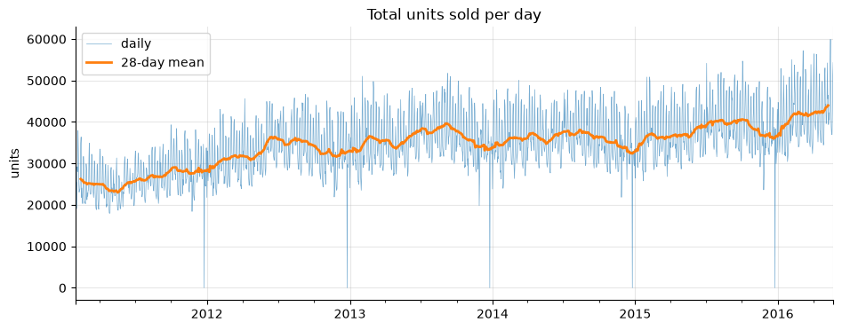
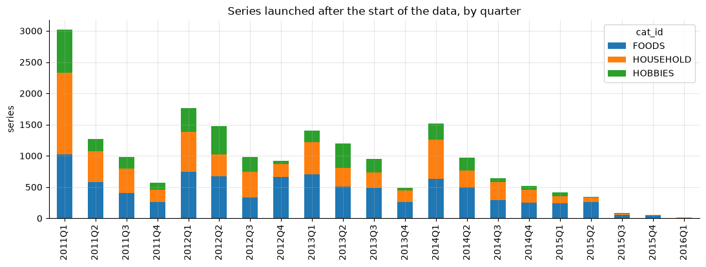
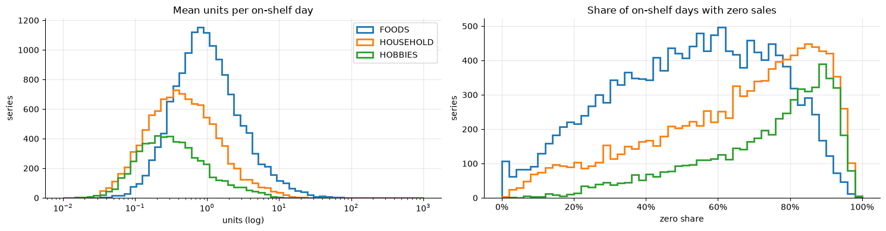
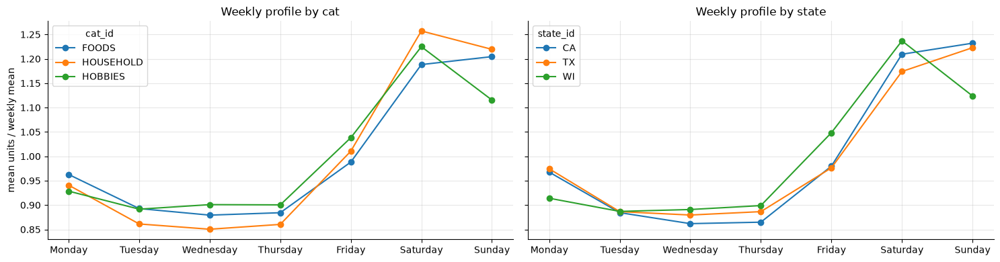
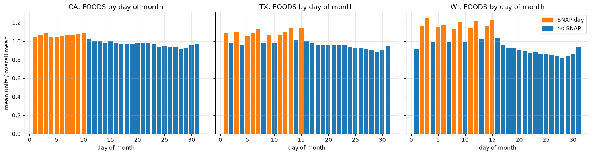
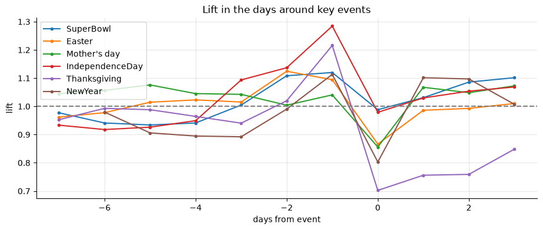

# Exploratory data analysis

What the M5 sales data looks like and the modeling decisions that follow from
it. Code, all figures and the full tables are in
[`notebooks/01_eda.ipynb`](../notebooks/01_eda.ipynb).

## Data

- **Sales:** daily units for 30,490 series (3,049 items × 10 stores), from
  2011-01-29 to 2016-05-22 (1,941 days). The stores are in California, Texas
  and Wisconsin; items fall into 3 categories (FOODS, HOUSEHOLD, HOBBIES) and
  7 departments.
- **Calendar:** day of week, holidays and other events, and SNAP days per state.
- **Prices:** weekly price per item and store.

Every item is listed in every store, and all integrity checks pass: unique
keys, no negative sales, positive prices, consistent links between the three
files and no gaps in the calendar. No cleaning or imputation is needed.

## Sales over time



- Total sales grow from about 25,000 to 42,000 units a day over five years.
- Christmas Day is the only near-zero day (11 to 20 units in total): the
  stores are closed.
- Sales are concentrated: California has 44% of all units, one store (CA_3)
  17%, and one department (FOODS_3) 49%.

**Decisions.** Store, state, category, department and item are categorical
features, since sales levels differ several-fold between them. Models learn
from recent history (lags, rolling means) to follow the trend, and are compared
with scale-free metrics (WAPE, MASE, RMSSE). Christmas Day is dropped from
training; it is a closure, not demand.

## Product launches



- Only 36% of series are on sale from the first day. The rest launch over the
  following five years.
- The days before a series launches are 21% of all series-days and 31% of all
  zero-sales days. They are not zero demand: the item was not on the shelf.
- A series' first week with a price is a reliable launch date. Nothing sells
  before it, and the first sale follows within 2 days at the median.

**Decision.** Pre-launch days are removed from features, training and metric
scaling. Counted as zeros, they would pull forecasts for new items down. This
matches the official RMSSE, whose scale starts at a series' first sale.

## Intermittent demand



- 60% of on-shelf days have zero sales. The median series sells 0.93 units a
  day in FOODS, 0.44 in HOUSEHOLD and 0.31 in HOBBIES.
- Sales rates span more than three orders of magnitude, from under 0.1 to
  over 100 units a day.
- Under the Syntetos-Boylan classification, 73% of series are intermittent
  (sold on few days, in steady quantities) and 18% lumpy (few days, varying
  quantities). Only 6% are smooth.
- Long runs without sales are common (48% of series have one longer than
  91 days), but with this many zero days they also happen by chance. They
  cannot be read as stock-outs from sales data alone.

**Decisions.**
- No MAPE or other per-series percentage error: it is undefined on zero days.
- LightGBM uses a Tweedie objective instead of squared error, as the target is
  a non-negative count with a large mass at zero.
- A moving-average baseline joins the naive and seasonal-naive ones: on
  intermittent series, last-value forecasts are mostly zero.
- "Days since last sale" is a feature. Demand class and sales rate are slices
  for error analysis.

## Weekly and monthly patterns



- Every category and state has a strong weekly cycle: Saturday and Sunday sell
  12% to 26% above the weekly mean, Tuesday to Thursday 10% to 15% below.
- FOODS sells up to 14% above average in the first half of the month and about
  10% below in the last week. HOUSEHOLD and HOBBIES are flat after the first
  three days.
- Month of year matters much less: with the trend removed, months move sales
  by at most 10%.

**Decisions.** Day of week, day of month and month are calendar features. Lags
and rolling windows are multiples of 7 days to keep the weekly phase, and the
seasonal-naive baseline uses a 7-day season.

## SNAP

SNAP is the US food assistance program. Benefits are paid on 10 days a month
that differ by state, and can be spent only on food.



- On SNAP days, FOODS sells 10% more in California, 15% in Texas and 30% in
  Wisconsin. HOUSEHOLD and HOBBIES, which SNAP cannot buy, gain only 1% to 3%.
- SNAP days all fall early in the month, when paychecks also arrive.
  Comparing only days 1 to 15, the FOODS lift drops to 6%, 12% and 20%, and
  the HOUSEHOLD and HOBBIES lift disappears.
- Wisconsin shows the effect most clearly: SNAP and non-SNAP days alternate,
  and FOODS sales follow them day by day.

**Decisions.** Each series gets the SNAP flag of its own state, as one feature.
Day of month stays a separate feature, so the model can tell SNAP apart from
the start-of-month effect. The SNAP calendar is published in advance, so the
feature is known at forecast time.

## Events and holidays



Lift is sales on a day divided by the same weekday 1 to 4 weeks before and
after.

- Most events change sales by less than 5%.
- Large holidays lower sales on the day itself: Thanksgiving by 30%, New Year
  by 20%, Easter and Mother's Day by about 14%. Labor Day is the exception, at
  26% above a normal day.
- Shopping moves to the days before: one or two days ahead of these holidays,
  sales are 10% to 28% higher.
- Averaged by event type, these effects cancel out, so the type alone carries
  little signal.

**Decisions.** Events are encoded by name, together with "days until the next
event" (capped at a week). Event days versus normal days is a slice for error
analysis.

## Prices

- Prices rarely change: the median series changes price 0.55 times a year in
  FOODS and about 0.3 times in HOUSEHOLD and HOBBIES.
- Prices are mostly the same across stores: in 64% to 82% of item-weeks, every
  store charges the same.
- Weeks priced below a series' median sell 13% to 30% more than usual, and
  weeks priced above it 5% to 16% less. This is a correlation, not an
  elasticity estimate: price changes also coincide with trend and launches.

**Decisions.** Price features are relative to the series' own history (price
over its recent maximum or median, and week-over-week change). Cross-store
comparisons are skipped. Forecasts need the price for the forecast days, so the
forecasting API takes planned prices as input.

## Summary

| Finding | Decision |
|---|---|
| 64% of series launch after the first day; pre-launch days are 31% of all zeros | Drop pre-launch days from features, training and metric scaling |
| Christmas Day is a store closure | Drop it from training |
| 60% of on-shelf days are zero; 73% of series are intermittent | WAPE, MASE, RMSSE (no MAPE); Tweedie objective; moving-average baseline |
| Sales levels differ several-fold across stores, departments and items | Hierarchy as categorical features; scale-free metrics |
| Strong weekly cycle; FOODS peaks in the first half of the month | Day of week, day of month and month features; windows in multiples of 7 days |
| SNAP lifts FOODS by 6% to 20% beyond the start-of-month effect | A SNAP feature from each series' own state |
| Big holidays lower sales on the day and raise them on the days before | Event name and "days until next event" features |
| Prices rarely change and are mostly uniform across stores | Price relative to the series' own history |
| Demand class, sales rate and event days behave differently | Slices for error analysis |

## Reproducing

```bash
uv sync
uv run python -m demand_forecast.data.download   # needs a Kaggle API token
uv run jupyter nbconvert --to notebook --execute --inplace notebooks/01_eda.ipynb
```

Running the notebook regenerates the figures in `docs/figures/`.
